# Architecture

## System boundary

HeritageFlow exposes one HTTP API to visitors, tenant administrators, and gate
validators. Authentication maps an opaque token to a tenant and role. Clients
cannot choose their effective tenant. The API is stateless; DynamoDB stores
tenant metadata, attractions, slots, reservations, idempotency markers,
validation records, and immutable event records.

Editable source: `diagrams/aws-architecture.mmd`.

## Request path

An Application Load Balancer distributes requests across at least two ECS
Fargate tasks. Tasks run in separate public subnets to avoid a NAT gateway's
fixed student-project cost; their security group accepts application traffic
only from the ALB. Production claims require an ACM certificate so the public
listener uses HTTPS.

Reservation creation uses one DynamoDB transaction to conditionally decrement
remaining capacity, insert the reservation, insert an idempotency marker, and
append an event. This makes capacity and the reservation atomic. DynamoDB
Streams invokes a Lambda function that forwards event records to a FIFO SQS
queue using the tenant as the message group. A downstream business consumer is
not yet implemented and remains an explicit gap for experiment E6.

## Scaling and resilience

The ECS service starts with two tasks and may scale from two to six using ALB
request count per target. DynamoDB uses on-demand billing and managed
availability. The architecture is single-region, multi-availability-zone; it
does not survive a full regional outage. Whether the scaling policy meets the
latency target is an experimental question, not a design assumption.

## Operations

ECS logs go to CloudWatch. Alarms cover ALB 5xx responses and the age of the
oldest SQS message, sending notifications through SNS. AWS Budgets provides a
monthly cost alarm. Application secrets are stored in Secrets Manager and
injected into the task. Terraform defines the environment from an empty AWS
account after prerequisites are supplied.

## Local equivalence and limits

Docker Compose runs the same API and DynamoDB access code against DynamoDB
Local. It proves keys, transactions, persistence, isolation, and restart
behaviour. It does not reproduce ECS scheduling, ALB behaviour, DynamoDB
service latency, Streams-to-Lambda delivery, CloudWatch, or AWS billing.
